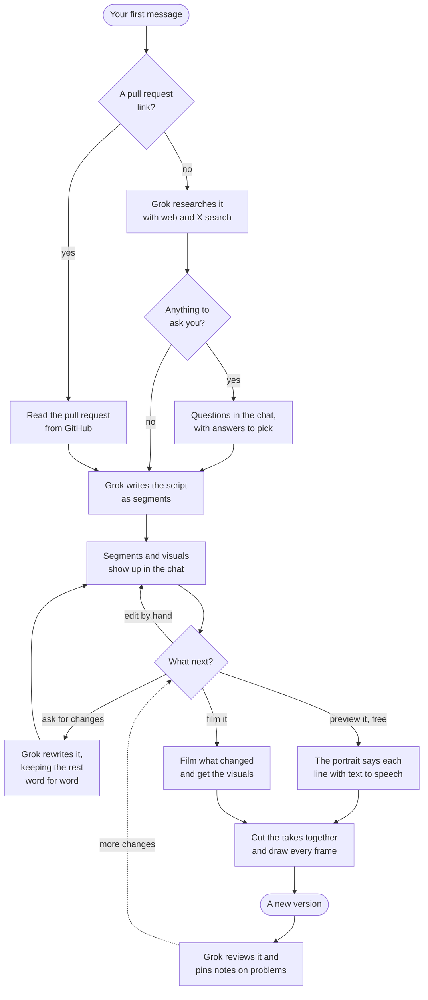
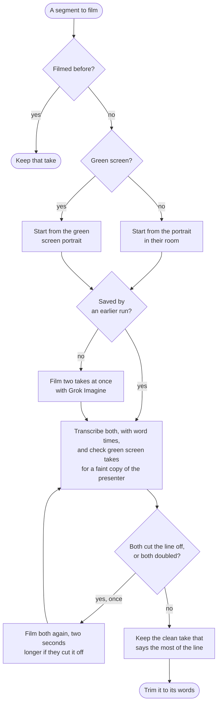
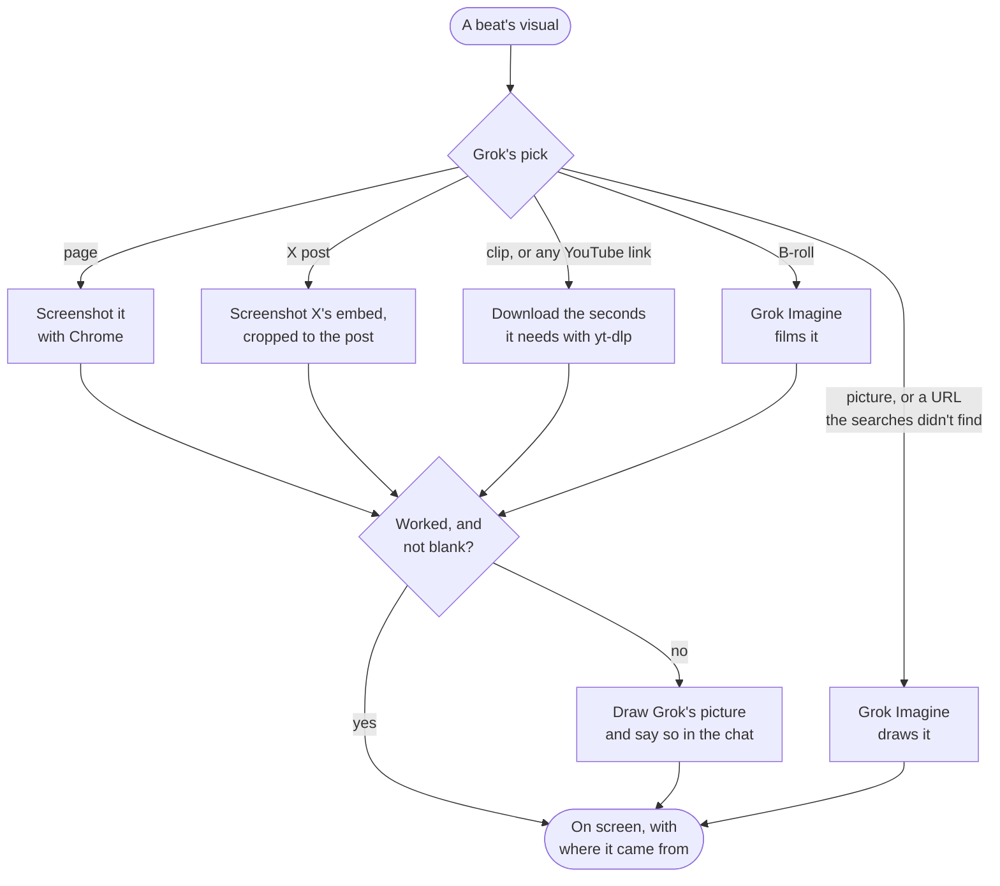
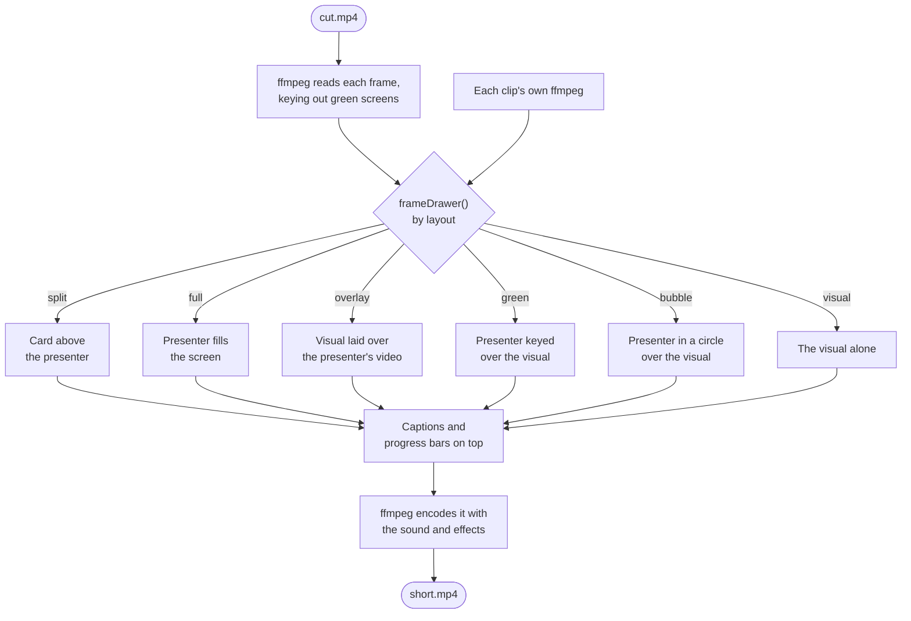
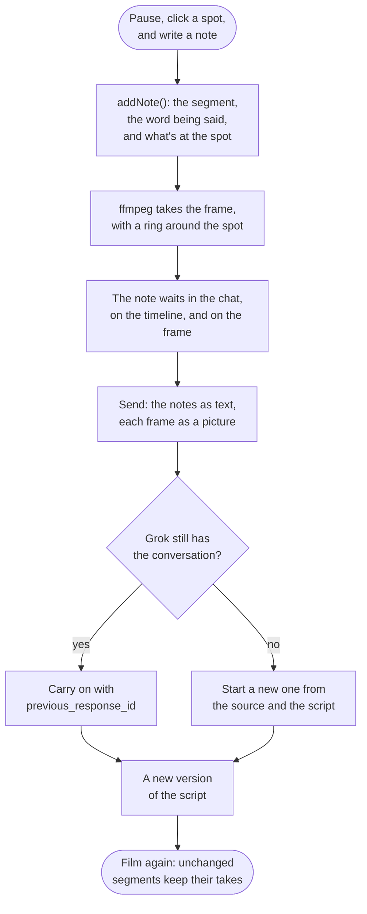
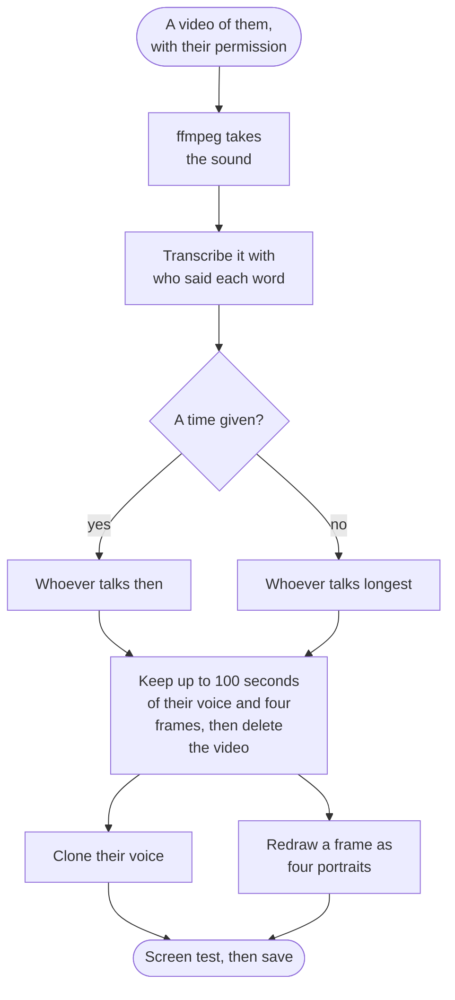

# Grok Shorts

This app builds an AI video explainer with the Grok API and Grok Imagine that turns a GitHub pull request, or any idea you type, into a half-minute vertical video, like a creator talking to the camera on TikTok. It shows how to research a topic and write a script with Grok in a chat, film a lifelike presenter saying the lines, keep them the same from cut to cut, and put code, screenshots, clips, and captions on screen in time with what they say, laid over the presenter's video or framed in a split screen, full screen, or a green screen, in colors and lettering that change from video to video.

Paste a link to a pull request, or describe a video, like "a 30-second history of the espresso machine", and pick a presenter, who comes with a personality of their own, like Maya, a hype creator, or Dev, a deadpan senior engineer. A video can take another personality, like a nature documentary narrator, or copy the style of an account on X. Grok writes a short, punchy script in that voice, in segments: a hook that says what the video is about and why anyone should care, a few beats, and an ending. For a pull request, a segment on why the change matters comes first, each beat puts rows of the diff on screen, and the ending is a verdict on whether it's safe to approve. For an idea, Grok first researches it with web search and X search, and each beat shows something real it found, like a screenshot of an article, an X post, or a few seconds of a video on YouTube, or a picture or a short clip that Grok Imagine makes. Each segment also has a layout: the presenter filling the screen with the visual laid over their video, the way a creator drops a screenshot onto what they filmed on their phone, the visual above the presenter, the presenter filling the screen, the presenter in front of the visual like a green screen, the visual filling the screen with the presenter in a bubble, or the visual alone. Grok lays screenshots, pages, posts, and clips over the presenter's video, keeps the split for the diff and the pull request, keys the presenter out only to stand them in front of a picture or video they can cover, and leaves the bubble for you to pick by hand. Grok also picks a theme for the words and stickers on screen to suit the video, like candy pop, a news ticker, or a chalkboard. Ask for changes in the chat, like a punchier hook, one beat fewer, a real clip of the thing you're talking about, or a Gen Z hook before a patient teacher walks through the rest, and Grok writes the script again with just those changes, or pick a segment's layout or the video's theme yourself. When it's right, Grok Imagine films the presenter saying each segment to the camera, twice, and the app keeps the take that says the line best, then cuts the takes together on their words, framed the way each segment says, with captions that pop up word by word. Filming again after more changes films only the segments that changed. Every video is saved as a project, so you can come back to it from Your Videos and keep going: pause on a moment, click the spot, and say what should change, and Grok gets each note with a picture of that frame. It works like a creator studio: every cut is kept as a version, a free preview plays the whole video with text to speech before you pay to film it, you can edit lines yourself and see what filming them will cost, pick between takes or retake one line, and Grok reviews each cut and pins notes on anything that looks broken. A brand kit puts your logo, colors, font, and an end card on every video, and a library keeps your own images, clips, and music to use in any of them. A second app, Presenter Studio, makes new presenters, from a description or from a video of a real person who agreed to it, each with a personality of their own, written from an idea or an X account and tried out in their voice before making a video with them.

## What you'll learn

- Write a script with Grok in a chat: carry each message on from Grok's last reply with `previous_response_id`, and get the whole script back each time, with the lines you didn't ask to change word for word
- Have Grok research a topic and ask what it can't look up before it writes, as structured output with answers to pick from
- Research a topic with web search and X search, and only show the pages, posts, and videos the searches actually turned up
- Show what the research found: screenshots of pages and X posts taken with headless Chrome, a few seconds of a video downloaded with yt-dlp, or B-roll that Grok Imagine films from a prompt
- Frame each segment six ways, from a screenshot laid over the presenter's video to a green screen, by drawing the presenter in front of a green screen once, filming those segments from that picture, and keying the green out with ffmpeg during just those segments
- Draw the words and stickers in one of ten themes that Grok picks to suit the video, each with its own colors, font, and style: sticker shapes from tape to hard blocks, captions that pop, box, underline, or fill in like karaoke, and endings from a rubber stamp to a news banner. Grok is told the themes of your last videos, so each one looks different, and a video can be drawn again in another theme without filming anything
- Write a hook and a script in a chosen personality, or in the style of an X account that Grok reads with X search
- Give each presenter a personality of their own: have Grok write one from an idea or an X account's posts, or change one that's there, then hear sample lines in the presenter's voice and act one out in a screen test
- Draw a photorealistic presenter with Grok Imagine, and start every take from that picture, so the presenter, their room, and the framing stay the same from cut to cut
- Make your own presenters: draw four portraits in one request, film a screen test, and have Grok find the face in the portrait, so the video frames anyone the same way
- Start a presenter from a video of a real person, with their permission: find who talks the most with diarized speech to text, clone their voice from what they say, and redraw their likeness with image editing
- Have the presenter say a line in a built-in or cloned voice with `reference_audios`, and direct how they react in the prompt
- Film two takes of every line at once and keep the one whose transcript matches the line best, film again, longer, when a take cuts the line off, and pass over a green screen take with a faint copy of the presenter mixed in, which can't be keyed out
- Film again only what changed, by keeping each take under what it was made from: the line, the mood, the presenter, and the personality
- Keep editing any video later, with its conversation, script, notes, and latest cut saved in its folder after every change
- Take notes on the video itself: pause, click a spot, and say what should change, and send Grok each note with the frame and the spot ringed, and the segment, the word being said, and what's at the spot
- Watch the whole video for a fraction of a cent before filming it: the portrait, still, says each line in the presenter's voice with `client.voice.speak()`, cut together and drawn exactly like the real thing
- Have Grok review a cut the way an editor would, from three frames of every segment sent as `input_image` parts with what's said and how it's laid out, and pin a note on each problem it sees
- Keep every cut as a version to go back to, pick between a line's takes yourself, and retake a single line with new direction
- Put a creator's brand on every video: their colors and font as a theme, their logo in the corner, and an end card after the last line
- Let Grok show the creator's own images and videos, by listing their uploads in its instructions as a kind of visual it can pick
- Let Grok read from remote MCP servers while it researches, with the `mcp` tool next to web search and X search, so a video can start from a Slack thread, a GitHub release, or a Notion doc
- Write a hook four ways and score them with structured output, and hear each in the presenter's voice before using one
- Write several scripts at once in the background, each previewed for free, to film only the ones worth it
- Trim and reorder takes on a timeline without filming them again
- Mix music under the voice with ffmpeg: loop it, even it out, dip it with `sidechaincompress` whenever the presenter speaks, and bring the whole mix to the loudness short video apps play at with `loudnorm`
- Line up a script with a transcript the way a diff lines up two files, so captions show the script's words at the moments they're said, even where the transcript mishears them
- Stream the script as structured output, and show each segment as soon as it's written
- Read video frames from ffmpeg, draw the code, screenshots, clips, and captions on them with a canvas, and pipe them to ffmpeg to encode, with sound effects that ffmpeg makes from formulas

## Run it

You need Node.js 22.13 or later and [ffmpeg](https://ffmpeg.org). Put your API key in `.env` at the root of the repo, or export `XAI_API_KEY`. To show screenshots of pages and X posts, you also need Google Chrome or Chromium, and to show clips from YouTube and X, [yt-dlp](https://github.com/yt-dlp/yt-dlp). Without them, those beats show a picture instead.

```bash
cd examples/grok-shorts/typescript
npm install
npm run web
```

Open http://localhost:3000 and write a link to a pull request, or an idea for a video, in the message box at the bottom of the chat on the left, or pick one of the ideas above it, with **More ideas** for others. Pick a presenter in the box, each in their own personality, like Stan, a wholesome teacher, and send it. Until there's a video, the phone in the middle shows the presenter, and the timeline under it shows where each segment of the script will go. A link can come with instructions, like "keep it under 20 seconds and aim it at people new to Hono". To give one video another personality, or copy the style of an account on X, open **Style** at the top of the details next to the video and pick it under Personality, or **Copy an X profile…** and type its handle, and Grok writes the script again in it, saying the same things another way. Grok's reply streams into the chat: what it read or searched for, a note on what it wrote, then each segment as it's written, folded into a card of the script once it's done. Like in a video editor, the segments are clips on the timeline under the phone, and picking one, there or on the card, shows its details in the panel next to the video: its sticker, its layout, how the presenter reacts, its line, and the rows of the diff, the page, post, or clip, or the picture it shows. Ask for changes until it's right. Each reply is a new version of the script. To change how a segment is framed, pick its layout in its details. The theme Grok picked is in **Style** too, which says the personality and theme while it's closed, and you can pick another theme the same way. Grok hears about either with your next message, so it keeps them.

For an idea, Grok researches it first, tells you what it understood, and asks up to three questions about what only you can tell it, like who the video is for, the point to make, or what to show, each with a few answers to pick from. Pick or write your answers, or tell it to go ahead, and it writes the script. Each version's screenshots, posts, clips, and pictures show up under its segments as soon as they're fetched, before anything is filmed, so you can ask for different ones. B-roll is filmed with the takes, since it costs as much as one.

**Film video** films the latest version. Each segment's screenshot, clip, or picture shows up under it in the chat as it's fetched, with a note under the reply when something real couldn't be fetched and a picture stands in for it. On the timeline under the phone, each segment's clip fills up as its takes render, then plays the kept take, with how much of the line it got right. The phone in the middle shows the progress, then plays the video, and the details panel follows the segment being said. Click a segment to jump to it. After more changes, **Film again** keeps the takes of the segments that didn't change. While a video is filming or previewing, its button turns into a stop button: takes that were done are kept for next time, and ones already started are still billed, since the API can't cancel a video once it's rendering. Changing a layout keeps the take too, except to or from a green screen, which is filmed differently. Changing the theme keeps everything, so filming again only draws the video again. Above the video, **Download** saves the MP4, **Copy transcript** copies the script as Markdown, to paste into the pull request under the video, and **New video** starts a new conversation. Each video is saved after every change, and the address in the browser opens it again, even after the server restarts.

Once a video is filmed, a timeline under the phone shows it: a ruler of seconds, the segments as clips over a strip of the video's frames, each outlined and named in the theme's colors, the music, if it has any, as a track of its own with its waveform, looped and faded the way it's mixed in, and a lane with a marker for each note. Click or drag anywhere on it to scrub, and play or pause it next to the time. To ask for a change in the video itself, click **📍 Add a note**, click the spot on the frame the note is about, and write what should change, like "the docs text is too small to read here" or "make this stamp say what to do". The note waits in the **Comments** tab next to the video, with a picture of its moment, as a marker on the timeline, and as a pin on the frame while that moment plays, when its comment lights up. The send arrow sends the notes along with anything you wrote. Grok gets a picture of each note's frame with the spot ringed, answers with a new version of the script, and says in its note if one asks for something the script can't change, like how the captions look. Asked to make a screenshot readable and to have the ending stamp say what to do, Grok gave the screenshot more of the screen and changed the stamp's words, keeping every line, so filming again kept every take and cost less than a cent.

### Working on a video

A segment's details show how long its take runs, and whether it's filmed already or needs a new take, and hovering over the Film button says how many new takes filming makes. The page doesn't show prices. What things cost is below, under the terminal. Click any line to change what the presenter says, and press Enter. A beat's details can move it earlier or later, cut it, or show one of your uploads on it with 🖼. Grok hears about every change with your next message and keeps it.

Pick the hook and click 🎣 for the hook lab: Grok scores the hook the video has from 1 to 10 for how likely it is to stop someone scrolling, says why, and writes four others from different angles, like a surprising number or a concrete symptom, each scored. **Hear it** says one in the presenter's voice, and **Use this** puts it in the script. For the ky fix, it scored "Ky extend was quietly cutting your retry limit. Three became two. Did you catch it?" a 7, since "the cute question softens a sharp bug", and offered "You set retry to three. Extend drops it. You get two." as an 8, in 6 seconds.

**Preview** plays the whole video before anything is filmed: the presenter's portrait, still, says each line in their voice with text to speech, with the captions, visuals, layouts, and theme exactly as the real cut will have them. The six-segment Manpreet video previewed in about a minute, in Stan's cloned voice, green screen and all. A badge on the phone says it's a preview, and filming it makes it real.

Under a segment's line are its takes, with the one the next cut uses outlined. Hover over a take to watch it, and click another to use it instead. **Retake** films two more takes of just that line, with whatever you write, like "more energy" or "slower", and uses the best of them. Your picks are saved with the video.

The timeline under the phone edits the video too. Drag a clip's edge to trim its take, cutting a pause from its start or end, or keeping more of it, and drag a beat to move it among the others. The **Media** tab next to the video has your uploads, with a button to upload more: drag one onto a clip to show it there, or click it to show it on the picked segment. Each change shows in the video the next time it's cut, and trimming or moving a beat films nothing new: trimming 0.2 seconds from the start of one segment and a second from its end made a preview exactly 1.2 seconds shorter. After a beat moves, the timeline waits for the next cut before it can be edited again, since its clips no longer line up with the script.

Once a video is filmed, anything changed since its current version is counted next to **Preview** and **Film again**. Open it to see each change, like a new line, another layout, theme, or presenter, or a trim, with the ones that need a new take marked, and preview or film again from there.

Every cut is kept. Pick one from the versions above the phone, newest first, to watch it, and **Go back to this version** makes it the video again, with the script it was filmed from. Previews are kept the same way, but never become the video.

The studio is made for shorts. An orange line under the timeline's ruler marks the hook, the first three seconds, which decide whether anyone keeps watching, and a badge next to the time says whether the video's length is in the sweet spot for a short, 15 to 45 seconds. **Safe zones**, in the corner of the canvas around the phone, shows on it where YouTube Shorts, TikTok, or Reels cover the video with their top bar, their buttons, and the caption and title, to keep words and screenshots out from under them. Click the phone to play or pause it. Space does the same, the arrow keys go to the segment before or after, M mutes, and N adds a note. The arrow at the top of the chat folds it away for more room to edit.

The **Publish** tab has what goes with the video when it's posted. Pick YouTube Shorts, TikTok, or Reels, and **Write with Grok** writes a title, a description, and hashtags for it from the script, as structured output, in the video's personality. They're kept in the browser for each video and platform, and **Copy all** copies them. Pause on the frame people should see first, and **Use this frame** makes it the cover, to download next to the video.

As soon as a cut or a preview is made, Grok looks it over for issues, and **Find issues**, in the Comments tab, looks again at whichever version is in the phone. Grok looks at three frames from every segment, each with what's said and how it's laid out, and pins a note, marked Grok, on each problem a viewer would notice, like a sticker covering a screenshot's headline, a caption over the presenter's mouth, or green edges around the presenter. A review took about 7 seconds. Send the notes with a message, or delete the ones you disagree with.

Above the segments, next to the theme, pick music from your library, or upload some, set how loud it is, and turn the sound effects on or off. The music loops for as long as the video runs, fades in and out, and dips about 11 dB whenever the presenter speaks. The whole mix is evened out to the loudness short video apps play at. Sound is mixed after filming, so changing it films nothing.

For a cleaner video, **On screen** in **Style** turns off the title, at the top of every frame and under the hook, and each segment's label on its sticker, leaving the captions, the hook, and the ending. They're drawn on after filming too, so turning them off films nothing.

### Apps, and several videos at once

**Apps**, at http://localhost:3000/apps, connects apps Grok reads from while it researches a video, like GitHub, Slack, Notion, or Linear, through their remote MCP servers. Pick one to start from, paste its token, and **Test** asks Grok which of the server's tools it can see. Then paste a link from it, like a GitHub release or a Slack thread, and Grok reads it there and makes the video about what it says: given a Hono release on GitHub, Grok called the GitHub server's `get_release_by_tag` and summed the release up in its note in 14 seconds. GitHub starts from its read-only server, and Grok is told to only ever read from an app, never to change anything in it. Tokens stay on your computer.

To make several videos at once, click **Batch** in the message box before a conversation starts, write one source on each line, a pull request, an idea, or a link from an app, and send them with the arrow, or Cmd+Enter, since Enter starts a new line. Grok writes all the scripts at the same time, in the presenter's personality, going ahead with its best judgment instead of asking questions, and each one gets a free preview. They show up in the chat as they're written: **Watch** plays a preview in the phone, and **Open** makes it the video you're working on, to change and film. Every one is a video like any other, and Your Videos has them as drafts until they're filmed. Two ideas took about three minutes to write and preview. The videos in a batch get different themes from each other, and from your last few videos. SpaceXSI's Batch API would cost less, but it doesn't take `grok-4.7`, so the scripts are written in the background instead, three at a time.

### Brand Kit and Library

**Brand Kit**, at http://localhost:3000/brand, puts your brand on every video you make and film again: a name, up to three colors and one of eleven fonts for the words and stickers on screen, among them Inter, which comes with the app in `typescript/fonts/` under the SIL Open Font License, since most computers don't have it, your logo in the top right corner of every frame, and an end card with your logo, name, and a call to action, like "Follow @xai for more", for 2.5 seconds after the last line. It also sets the presenter new videos start with, in their own personality. New videos start in your brand's theme, which Grok can't change, and the theme menu has it first. A preview on the page shows a frame and the end card as you change them.

To start from your website, type it, like x.ai, and click **Fill from website**. Chrome opens the site, the way an ordinary browser does, since some sites turn away bots, and Grok gets its HTML, a screenshot of the top of it, and every image that might be its logo, drawn on a dark background the way the video shows it. It fills in your name, up to three colors, the font and look closest to the site's, your logo, and a call to action with your X account if the site links one. A dark logo is drawn white, since it sits on a dark video. Nothing is saved until you click **Save Brand Kit**. Stripe, Vercel, Notion, and x.ai each took 6 to 15 seconds.

**Library**, at http://localhost:3000/library, keeps the images, videos, and music you upload, for any video: screenshots of your product, logos, clips you filmed, or music you have the rights to. Grok is told what's in it, by name and shape, and shows your uploads where they fit what's being said, and you can put one on any beat yourself. An image is shown whole, and a video fills the space like a clip.

**Your Videos**, at http://localhost:3000/videos, shows every video you've made, newest first, even after the server restarts, with the ones written but not filmed yet, like a batch's, as drafts, showing their preview if they have one. Click one to play it, with what it was about, who presented it, its transcript, and a download link. **Keep editing** opens it on the main page with its conversation, script, notes, and latest cut. A video made before the app saved projects opens from what it saved about itself, and Grok carries on from its script.

To make a video from the terminal instead, pass a link or an idea in quotes, a presenter, `maya`, `dev`, or one you made in Presenter Studio, and for another personality than the presenter's own, one of `hype`, `deadpan`, `genz`, `documentary`, `sports`, `conspiracy`, `teacher`, `founder`, one you made in Presenter Studio, or an X handle with its `@`. The terminal films Grok's first script, without a chat:

```bash
npm start -- https://github.com/honojs/hono/pull/5513 dev documentary
npm start -- "Why do cats knock things off tables? Three theories, ranked." maya documentary
npm start -- https://github.com/honojs/hono/pull/5513 maya @levelsio
```

Without arguments, Maya explains a fix to how [ky](https://github.com/sindresorhus/ky) merges its retry options, as a hype creator. Both save everything to a folder in `output/` named after the pull request, like `output/sindresorhus-ky-867/`, or after the idea: `short.mp4`, every take as `take-<id>-<letter>.mp4`, what each beat of an idea shows, like `page-<id>.png`, `clip-<id>.mp4`, or `picture-<id>.jpg`, `cut.mp4` with the kept takes cut together before the cards and captions go on, `script.json` with the theme, the segments, when each one starts, and each take's prompt, length, cost, and how much of its line it said, and `transcript.md`. The web app also saves `project.json`, with the conversation, the latest script, the notes, every cut, and the takes you picked, `cuts/`, with every cut and preview as `<when it was made>.mp4`, and next to each, `-filmstrip.jpg`, a frame of it for each second, side by side, for the timeline, `notes/`, with a picture for each note, and `preview/`, with each line said by text to speech over the portrait, which a preview uses again until the line changes. The brand kit is saved in `output/brand/`, the library in `output/library/`, with the list of uploads in `library.json`, the connected apps in `output/apps.json`, with their tokens, and each batch in `output/batches/`. Everything in `output/` stays out of git. A take or a visual is named after what it was made from. Making the same segment again, even after the server restarts, hears its saved takes again instead of filming them, and uses its saved screenshot, clip, or picture instead of fetching or drawing it again. The presenters' portraits are kept in `output/presenters/`, with `<id>-green.jpg` next to them once they've been in front of a green screen.

### Presenter Studio

Open http://localhost:3000/studio, or click **Presenter Studio** at the top of the video app, to make a presenter of your own, or change one under **Start from**. Describe them, where they film, and their voice, or type an idea, like "a pirate who became a staff engineer", or nothing at all, and click **Surprise me** for Grok to make someone up, personality and all. **Hear** says the screen test line in the voice. **Draw four portraits** draws four takes on them to pick from, **Screen test** films a few seconds of them saying the line, so you can see them move and hear them before you commit, and **Save presenter** adds them to the video app, with a link to make a video with them. Four portraits cost 16 cents, a screen test about 70 cents, and the rest less than a cent. The studio saves each presenter to `output/presenters/<id>.json`, next to their portrait.

If you have a video of the person you want, like yourself talking to the camera, start from that instead. Under **Start from a video of them**, pick the video, confirm that it's you or that you have their permission to use their face and voice, and click **Use this video**. The studio copies whoever talks the most, or if you give a time, like `0:02`, whoever is talking then, which picks one person out of a recorded call. It describes how they look and where they are, plays back the voice it took from them so you can check it's the right person, and shows four frames of them. Pick the frame that looks most like them, and **Draw four portraits** redraws it as portraits framed like every other presenter's, calm and facing the camera, in the same place. With **Clone their voice** checked, the studio also makes a custom voice from what they say and picks it for the presenter. Reading a 20-second video took 7 seconds, and a 30-minute call about 25 seconds. Four portraits from a frame cost 25 cents, and a 6-second screen test in the cloned voice cost 85 cents.

Cloning a voice through the API takes an Enterprise plan. Without one, the studio says so, and you can pick a built-in voice instead. A custom voice stays on your account until you delete it with `client.voice.custom.delete()`, and every **Use this video** with cloning makes a new one. Our account could have 30.

Every presenter has a personality: how they talk, and how they act it out on camera. Pick one under **Personality**, built in or yours, or type an idea, like "a pirate who became a staff engineer", and click **Write it**, or an X handle, like `@levelsio`, and click **Copy their style**, and change anything under **How they talk and act**. **How they sound** has Grok write a few lines in it: the hook, a beat, and the ending of a video about a topic you give, or a few kinds of videos of its own. **Hear it** says a line in the presenter's voice, and **Screen test** films them saying it, acted the way the personality says. **Save presenter** saves a personality written or changed here as one of yours, then the presenter with it, and a presenter already saved, or a built-in one, can change their name, voice, or personality without drawing new portraits. Writing a personality or its lines costs a fraction of a cent. Personalities are saved to `output/personalities/<id>.json`, and the terminal takes them by their id.

Public repositories work without a token, but GitHub allows only 60 requests an hour without one, and each video takes three. For private repositories, or more videos, set `GITHUB_TOKEN`, for example with `export GITHUB_TOKEN=$(gh auth token)`.

Writing and changing the script costs a few cents a message, with research. Filming takes about two minutes, nearly all of it rendering takes, and costs $10 to $20 for a whole video. Takes cost about 14 cents a second, and every line is filmed twice. A 60-second video on why one user stopped using Grok Bot, with six segments of up to 35 words each, cost $19.72. When we filmed the espresso idea, five segments and three pictures cost $9.46 for a 27-second video, and after we changed its ending, filming it again cost $1.14, for the one new segment. A 27-second video on speedcubing, with a screenshot, a clip from YouTube, B-roll behind the presenter in front of a green screen, and five segments in four layouts, cost $11.65. B-roll costs about 14 cents a second like a take, screenshots and clips cost nothing, and the green screen portrait costs 7 cents, once for each presenter. When we ran the ky sample in @levelsio's style, it filmed twelve takes of 5 to 12 seconds for $13.32 and made a 34-second video. Filming each line once costs about half as much: set `TAKES_PER_LINE` in `src/takes.ts` to 1. A preview takes about a minute and costs less than a cent, and a review by Grok a few cents at most. A picture costs 4 cents, and so does drawing a new presenter, once. Closing the page stops the app, but takes that have started still render and are billed, because the API can't cancel a video.

## How it works

The whole flow, from your first message to the finished video:



Each step, with the code in `src/`:

1. `startDraft()` in `short.ts` looks for a link to a pull request in the first message. With one, `readPullRequest()` in `github.ts` makes three calls to the GitHub REST API, for the pull request, its files, and its commits, and splits each file's patch into rows, keeping each row's line number before and after the change. The rest of the message goes to Grok as what you'd like from the video. Without a link, the message is the idea for the video.
2. The personality is one of `PERSONALITIES` in `persona.ts`, each with a `style` for how the lines are written and a `delivery` for how the presenter acts them out. For an X handle, `personaFromX()` gives `grok-4.7` the X search tool limited to that one account with `allowed_x_handles`, and asks it to describe the account's style as structured output: a name, a one-line summary, how they write, with example lines on other topics, and how they'd come across on camera. It found and read @levelsio's posts in about ten seconds. The presenter borrows the style, not the person: the script never uses their name or speaks as them, and the presenter keeps their own face and voice.
3. `writeScript()` in `script.ts` asks `grok-4.7` for the script as structured output, starting with a note to you about what it wrote. For a pull request, Grok gets the personality, the description, the commit messages, and each file's diff with its rows numbered. The hook has to name the project and lead with the stakes in plain words, like "If you use ky, your retry limit might be lying to you." The why gives the context: who runs into this, what it costs them, and why the pull request exists. Then come two or three beats that each name a file, the rows to highlight, a sticker, and a mood, and a verdict. For an idea, a first request with the web search and X search tools asks Grok to research it and say what it understood, and to ask, as structured output, what it still needs to know that it couldn't look up, with answers to pick from. That reply is stored too, and the script waits for the answers, or starts right away if there are no questions, carrying on from the research with `previous_response_id`. Grok is told to look up each product, company, or person the video is about, not only the words of the request, and to show the product itself where it can: for a video about why someone stopped using Grok Bot, it screenshotted Grok Bot's launch and enterprise pages. The script request has the same tools, and Grok researches before it writes: for speedcubing, it searched the web for the world record and for how speedcubers solve, and X for record solves with video, in about 15 seconds. It writes a title, a hook, two to four beats, and a closer, and keeps facts true unless you ask for something made up, like a story. Each beat names its visual: a page, a post, or a video Grok found, with the second to start a clip from, or a picture or a clip for Grok Imagine to make, with a picture to draw instead if the real thing can't be fetched. Either way, Grok picks one of the ten themes in `themes.ts` for the words on screen, from a line in the prompt that says what each looks like, like "neon, glowing magenta, violet, and cyan in narrow letters": it picked neon for the ky fix as a hype creator, and candy pop for why cats knock things off tables in Gen Z slang. And the script becomes a list of segments, each with a line, a mood, what's shown, and a layout, and how it's acted when that isn't the personality's way, like a burst of Gen Z energy on a hook before a calm teacher takes over. The stream's `json` event hands over the reply so far, and each segment is shown as soon as the next one starts, since Grok writes them in order. A beat for a file Grok wasn't shown is dropped, and rows outside a file's diff are pulled back inside it. A beat can only show a page, post, or video that the searches turned up: every URL in the searches' results and citations is kept, by an ID that's the same however the URL is written, and a beat with any other URL shows its picture instead, so a URL Grok made up never gets fetched. A YouTube video always plays as a clip, since a screenshot of its page only catches it loading. The request uses low reasoning effort: at medium or high, Grok spent over three minutes and 12,000 reasoning tokens on a four-file pull request before writing anything.
4. Grok is told the most words it can write, from 80 to 140 depending on the size of the change, or 110 for an idea, unless you ask for a length. Asked for "about" a number, it wrote a third to a half more. Asked for a video under 20 seconds, it wrote 113 words, about 40 seconds, until the instructions said the presenter says about three words a second, with an example: 60 words for 20 seconds. Then it wrote 49 to 62.
5. Each reply is stored with `store: true`, and `reviseScript()` sends your next message with `previous_response_id` set to Grok's last reply, so Grok carries on from it without the pull request being sent again. Grok writes the whole script again, changed only as you ask, and keeps every other line word for word. Asked for a funnier hook and a different mood for one beat, it changed those two and sent the other three segments back exactly as they were. A new personality goes along with the message, and so does any layout you picked by hand since Grok's last reply, so Grok keeps it.
6. `drawPresenter()` in `presenter.ts` draws a built-in presenter's portrait with `grok-imagine-image-2.0` the first time they're used: a photorealistic phone video frame at 9:16 of them where they film, framed from the chest up in the lower half, with room above their head. Then `findFace()` sends the portrait to `grok-4.7` as an `input_image` and asks for the center of the face as structured output. It placed the built-in presenters' faces within about two percent of where we measured them. The portraits are all framed the same way, but a face can still land higher or lower, and the video uses this to keep the face in the same spot whoever the presenter is. Presenter Studio saves its presenters the same way.
7. `filmDraft()` in `short.ts` films every segment at once with `recordTake()` in `takes.ts`. It calls `client.videos.generate()` with `grok-imagine-video-1.5`, the portrait as `image`, and the presenter's voice as `{ voice_id }` in `reference_audios`. The prompt quotes the line, gives the personality's delivery, or the segment's own acting when it has one, says how the presenter reacts, like "their eyebrows shoot up and their jaw drops", and when there's a card above them, has them point up at it. It polls `client.videos.get()` for progress, downloads the take, and transcribes it with `client.voice.transcribe()`, which gives each word a start and end time. Every second of a take is billed, so a take is only a little longer than its line, at about 2.8 words a second. Each kept take is remembered under the presenter, their voice and room, the personality's delivery, and the segment's line, mood, acting, and what's shown, so filming again reuses every take whose segment didn't change. Its files are named after the same things, so takes saved before the server restarted are transcribed again rather than filmed again.
8. A segment in front of a green screen is filmed from a second portrait. `drawGreenPortrait()` in `presenter.ts` asks `client.images.edit()` for the same person, framing, and light in front of a flat green screen, once for each presenter, and saves the green it came out as. The prompt for those takes says they film in front of a green screen. Grok Imagine kept the green flat for a whole take, the same color to within a few points in every frame we measured, so ffmpeg's `chromakey` and `despill` filters cut the presenter out cleanly, hair included. `chromakey` fades out pixels by how far their color is from the green, and gray, black, and white are only about 0.2 away, so the fade ends at 0.15: with it ending at 0.21, a dark sweater came out 11% see-through. The filters run in the ffmpeg that reads the cut, with `enable` set to the times of the green screen segments, so every other segment comes through untouched. Now and then, Grok Imagine films a doubled take, with a faint copy of the presenter mixed into the frame. In front of a green screen, the copy tints the green, and where it overlaps the presenter, it turns them see-through, so the page behind showed through their face. `tintedShare()` in `takes.ts` measures how much of a take is tinted green without being the screen, comparing colors the way `chromakey` does: under 2% of the pixels in clean takes, and 8.5% in a doubled one.
9. Each line is filmed twice at once. A take whose last word runs into its end, or whose transcript is missing a quarter of the line, cut the line off. Of the others, the one whose transcript matches the most of the line is kept, and if both cut it off, both are filmed again, two seconds longer. In front of a green screen, a doubled take loses to a clean one, of two that say as much, the less tinted one wins, and if both are doubled, both are filmed again. The transcript has the words as heard, which can mangle code names: "onError" came back as "Onunka" and "an encore". So `lineUp()` lines the script's words up with the heard words the way a diff lines up two files, pairing words that start the same, and each word of the script gets the time of the heard word it pairs with, or a time between its neighbors'. The captions show the script's words at those times.



10. `media.ts` gets what each beat shows, right after each version of the script is written, with `previewVisuals()` in `short.ts`, so the page can show it in the chat. Filming uses the same ones and adds the B-roll. Each fetch is kept in the conversation from the moment it starts, so a preview and a cut that want the same one share it. `screenshotPage()` runs Chrome in headless mode for a screenshot 1080 pixels wide and 2400 tall, which scrolls slowly while it's on screen. Each screenshot gets its own throwaway profile: with the default one, headless Chrome shared the profile of a Chrome that was already open, and handed its work over or hung. The page gets six seconds of its own time to run its scripts, and the screenshot is taken 15 seconds in at the latest, since docs.x.ai keeps working in the background and never runs out of things to wait for. A link to a docs page's Markdown copy, which ends in `.md`, is screenshotted as the page itself, and a screenshot that comes out entirely one color counts as failed. Sparse pages, like docs with thin text on white, were as much as 91% one color, as much as a page that was still loading, so the check only catches pages that drew nothing. `screenshotPost()` screenshots an X post through X's own embed page, which needs no login, and crops it to the post. In headless Chrome, the embed sometimes draws nothing, and then the beat shows its picture. `downloadClip()` has yt-dlp download only the seconds the beat needs, from where Grok said to start. `filmBroll()` films a clip from Grok's prompt with `grok-imagine-video-1.5` and no picture to start from, and `drawPicture()` draws a picture with `grok-imagine-image-2.0`, both in the shape of the space they fill, and with no words, since image models garble lettering. Anything real that can't be fetched becomes the picture Grok described in its place, with a note to you saying so. Everything real is credited on screen with where it came from, like `x.com/@handle` or `youtube.com`.



11. `filmDraft()` cuts the kept takes to their words, from just before the first to just after the last, and joins them into `cut.mp4` with ffmpeg at 30 frames a second. Each cut is a whole number of frames long, for the sound as well as the picture, so the lips stay in sync to the end. Then `compose()` reads the cut frame by frame from one ffmpeg as raw pixels, draws each finished frame with `frameDrawer()` in `frames.ts`, and pipes it to a second ffmpeg, which encodes it with the cut's sound. ffmpeg also makes the sound effects from formulas and noise, so the app has no sound files: a boom when the presenter is shocked, a whoosh on every cut, and a bell for the ending. Music from the library loops for as long as the video, evened out with `loudnorm` first, so a quiet song and a loud one sit at the same level, and `sidechaincompress` dips it with the presenter's voice as the key. Then `loudnorm` brings the whole mix to the -14 LUFS that short video apps play at: a preview with music measured -15.5. A clip plays from its own ffmpeg, one frame for each frame of its segment, and that ffmpeg decodes no more frames than the segment shows: blocked writing frames nobody reads, ffmpeg waits out a polite stop, so a clip's ffmpeg that's stopped early is killed outright.
12. `frameDrawer()` draws each segment's card the way its layout frames it: the hook in huge letters, the pull request's title, size, and description, a beat's rows of the diff, a screenshot, post, clip, or picture, or the ending stamped on. In a split, the card goes above the presenter over a blurred, darkened copy of the take, so it never covers their face. In a split and in front of a green screen, the presenter's face sits low in the bottom of the frame and the captions go in the gap above their head, so they don't cover it. In full screen, the take fills the frame and the hook or the ending goes above their head, where every portrait leaves room. Laid over, the take fills the frame too, and the visual goes above their head at its own shape, with rounded corners and a shadow, the way a creator drops a screenshot onto their video. Otherwise the visual fills the screen: a screenshot scrolls, a post is shown whole, and anything wide, like a landscape clip, goes across the screen over a blurred copy of itself, with the presenter in a circle in the corner, keyed out in front of it, or not at all. Keyed out, the presenter stands in front of the visual and covers the bottom of it, over a blurred copy of the visual. It doesn't know what kind of video it's drawing, only the cards and their layouts. The presenter's face is in the same place in every cut, alternating between a wider and a closer shot the way creators zoom on jump cuts, with a punch in and a shake when the presenter is shocked. The cards slide in as their segment starts. Shrinking the take to a few pixels and stretching it back blurs it in a fraction of the time a blur filter takes. The captions show up to three words, each popping in as it's said, with the word being said in the segment's color. Outside a split or a green screen they go over the presenter's chest, above the bottom fifth of the frame and narrower than it, where YouTube Shorts, TikTok, and Reels draw their own caption, title, and buttons, and the visuals laid over the take start under the apps' top bar. Each segment takes the next of the theme's colors, for its sticker, the word being said, the stamp, its bar along the top, and the ring around the bubble, with near black or white words on the sticker, whichever has more contrast, so a video changes color from segment to segment and still looks like one video. The big words are in the theme's font, from Arial Black to Marker Felt and a typewriter, with fonts like it on Windows and Linux, and neon glows. A brand kit's logo goes in the top right corner, level with the tag, drawn with its shadow once at the start: a shadow drawn on every frame made a preview take twice as long. Its end card is drawn over 2.5 seconds of black that `cutTakes()` adds after the last line.



13. Every video is a project, saved as `project.json` in its folder by `saveProject()` in `project.ts` after each reply, hand edit, note, and cut: the latest draft, with Grok's `responseId`, the messages to show again, the notes, and the latest cut, with when each segment and word plays in it. `loadProject()` opens one again. A video made before projects were saved is rebuilt from its `script.json`, with the pull request read again from GitHub, and segments made from the raw script an older version saved, if that's all it has. Grok keeps a conversation for a while, not forever, and a rebuilt video has none, so when there's no `responseId`, or `previous_response_id` comes back with a `NotFoundError`, `reviseScript()` starts a new conversation with what the video is about, as Grok was first told, and the script as it is now, in the shape Grok writes it. `addNote()` finds the segment at the note's moment, the word being said from the cut's word times, and what's at the spot with `spotAt()` in `frames.ts`, which knows where each layout puts the captions, the sticker, the presenter, and the bubble. ffmpeg takes that frame at half size, and canvas draws a ring around the spot. `notesMessage()` lists the notes, each with its time, segment, word, spot, and the segment's line, and the frames go with the message as `input_image` parts, so Grok sees what you saw.



`src/server.ts` keeps each open video while it runs: its project, which it saves after every change, and the takes and visuals made for it so far. `POST /api/chat` answers a message with Grok's reply, and `POST /api/film` films the latest script, both as server-sent events that `public/index.html` reads from the response with `fetch()`. `POST /api/film` with `preview` makes a preview instead. `POST /api/layout`, `POST /api/theme`, `POST /api/line`, `POST /api/segment`, `POST /api/upload-visual`, and `POST /api/sound` change a segment's layout, the theme, a line, a segment's place, a segment's visual, or the sound by hand, and `POST /api/estimate` says what filming the latest script would cost. `POST /api/takes` lists each line's takes, `POST /api/take` picks one, and `POST /api/retake` films more of one line. `POST /api/open` opens a video from its folder, `POST /api/cut` shows one of its versions, and `POST /api/restore` goes back to one. `POST /api/notes/add` and `POST /api/notes/remove` add and take away notes, and `POST /api/review` has Grok review a cut. `POST /api/hooks` runs the hook lab, `POST /api/changes` lists what changed since the current cut, `POST /api/publish` writes the title, description, and hashtags for a platform, and `POST /api/trim` trims a take. The brand kit is under `/api/brand`, the library under `/api/library`, the Apps page, `public/apps.html`, under `/api/sources`, and batches at `POST /api/batch` and `GET /api/batches`. `GET /api/videos` lists the videos for `public/videos.html` from the folders in `output/`, using the `script.json` saved next to each one, so the list doesn't depend on the server remembering anything. The server serves only the files it saved, in byte ranges so the browser can seek in the videos. `src/index.ts` writes and films a video in the terminal.

Presenter Studio is `public/studio.html`, served by the same server, with its own routes under `/api/studio/`. `inventPresenter()` in `src/studio.ts` asks `grok-4.7` for a presenter as structured output, with the voice an enum of the voices the video model takes, listed with their genders so Grok can pick one that fits. Asked only to surprise, Grok drew nearly the same person twice in a row, in their late twenties with silver hair and a cardigan, so a surprise starts from an age, a vibe, and a place picked at random. Presenters are always adults. `drawPortraits()` draws the four portraits in one request with `n: 4`, `filmLine()` in `src/takes.ts` films the screen test the same way as a take, and saving runs `findFace()` on the portrait you picked. The studio only takes back portraits it drew itself.

Starting from a video, the page sends the file as is, and the server won't read it unless you confirmed you may use it. Once it's read, the server deletes it and keeps only the frames and the voice sample, since a video can have other people in it. `readVideo()` in `src/studio.ts` has ffmpeg take the sound of the first 30 minutes as 16 kHz MP3 and transcribes it with `diarize: true`, which says who said each word. The person is whoever is talking at the time you gave, or else whoever talks longest. Their speech is split into stretches, each ending when they pause for most of a second or someone else talks. Stretches under a second and a half are left out, since in a call they're mostly "yeah" and "mm-hm" said over someone else, and up to 100 seconds of the rest is cut from the video's own sound, not the 16 kHz copy, and joined into the voice sample with ffmpeg's `atrim` and `concat` filters, so nobody else's voice ends up in the clone. With a time, the frames come from the stretch they're talking in then. Without one, they come from the middles of their four longest stretches, since a call can take a moment to switch to whoever starts talking. In a 30-minute call we tried, the person asking the questions was only a thumbnail next to a shared screen after the first few seconds, so frames from their longest stretches showed the screen, and frames from the time we gave showed them. `grok-4.7` describes them and where they are as structured output, naming a place even when the picture is a video call, since takes say where the presenter films. `cloneVoice()` uploads the sample with `client.voice.custom.create()`, and the voice ID it returns goes in `reference_audios` like a built-in voice. Given a frame, `drawPortraits()` calls `client.images.edit()` instead of `generate()`, asking for the person in the picture, keeping their exact face, hair, and build, framed the same way as the other portraits.



A presenter's `personality` is the id of one, and `personalityOf()` in `src/presenter.ts` gives it, or a hype creator for presenters saved before they had one. Presenter Studio writes and tries out personalities with the routes under `/api/personalities/`. `inventPersonality()` in `src/persona.ts` asks `grok-4.7` for a personality as structured output: a name, a summary, how they talk, with example lines on other topics, and how they act on camera. Like a surprise presenter, a surprise personality starts from a kind of person and an energy picked at random, like a lighthouse keeper with a grumpy energy, since asked only to surprise, Grok comes back to the same few ideas. An X handle goes to `personaFromX()`, the same as copying an X profile in the video app. `sampleLines()` writes a line for each thing to try, in order, as structured output, and the screen test is `filmLine()` with the personality's delivery in place of the presenter's, the way a take is acted. `savePersonality()` saves it under an id made from its name, and `listPersonalities()` and `findPersonality()` give the video app and the terminal the built-in personalities and yours. Asked for "a pirate who became a staff engineer", Grok wrote "Staff pirate", who talks in short lines with sea slang folded into engineering terms, like "That config be a leaky hull, matey. Patch it before we ship", and in the screen test, Stan leaned in with his brows raised and chopped the air like a captain briefing the crew.

The app has one dependency besides the SDK, `@napi-rs/canvas`, to draw the frames. Node can't draw text by itself, and neither can the ffmpeg that Homebrew installs, which is built without the libraries its text filters need. Canvas uses the fonts on your system, with fonts for emoji after the main ones. Apple's emoji font has no small sizes of some newer emoji, which then don't draw at all, so emoji are never drawn smaller than 60 pixels, and an ending too long for one line at a good size goes on two.

A few things we learned about the takes:

- Starting a take from the portrait with `image` keeps the framing. With the portrait in `reference_images` instead, the presenter looked the same, but the camera moved in for a close-up partway through, which would put their face under the code.
- The prompt has to say where the presenter is. Told only that they film "at their desk", a presenter whose portrait was in a train compartment cut to a living room half a second into the take. So each take's prompt names their room and asks for one continuous shot that starts from the picture.
- Reference-to-video renders at 720p at most, and asking for 1080p returns a 400 error. The takes are 720 by 1280, and the finished video is 1080 by 1920 around them.
- Pictures and B-roll are made in the shape of the space they fill. Cropping a 4:3 picture or a landscape clip to fill a vertical screen left a sliver of it, like the torso of the person in a clip, so a full screen layout gets a 9:16 picture or B-roll, and a real landscape clip is shown whole across the screen.
- Starting every take at once sometimes dropped a connection before the API answered. The SDK doesn't resend a request that creates something in that case, since the first one might have gone through, so the app tries again, up to twice.

To add a presenter, use Presenter Studio, or add one to `BUILT_IN` in `src/presenter.ts`. The video model takes every voice that `client.voice.list()` returns except `aurora` and `liora`, and custom voices. To add a personality, use Presenter Studio, or add one to `PERSONALITIES` in `src/persona.ts`.
